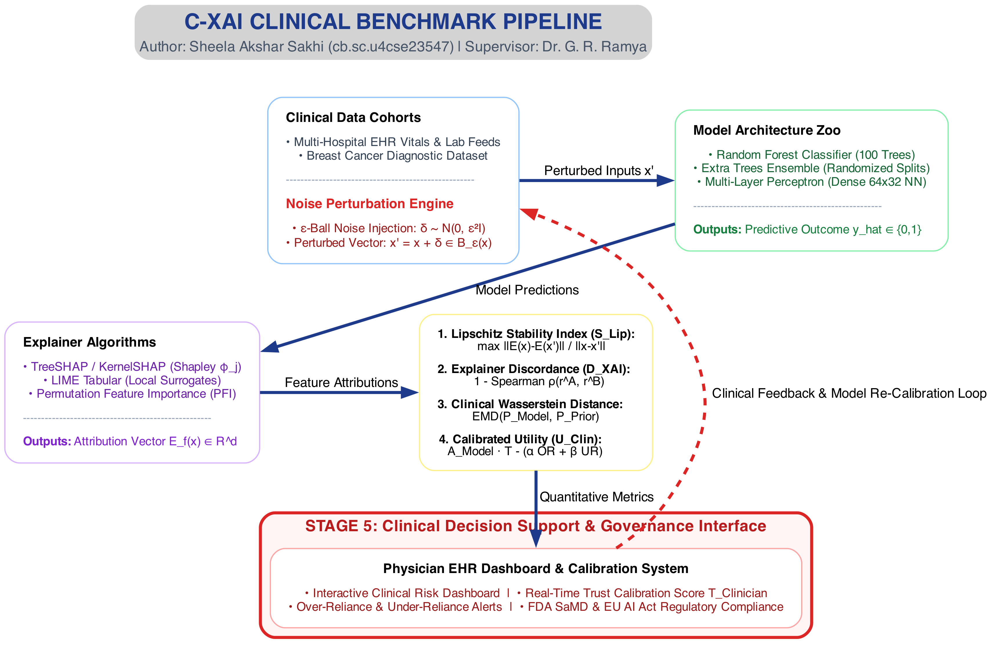

# C-XAI: Clinical Explainable AI Quantitative Benchmark & Python Package

[-blue.svg)](paper/main.pdf)
[-orange.svg)](presentation/presentation.pdf)
[-purple.svg)](CONFERENCE_DETAILS.md)
[](setup.py)
[](Dockerfile)
[](LICENSE)

---

## 📌 Project Information & Author Attribution
* **Author**: Sheela Akshar Sakhi
* **Roll Number**: `cb.sc.u4cse23547`
* **Department**: Department of Computer Science and Engineering, Amrita School of Computing
* **Institution**: Amrita Vishwa Vidyapeetham, India
* **Faculty Supervisor**: Dr. G. R. Ramya
* **Primary Contact**: `cb.sc.u4cse23547@cb.students.amrita.edu`

---

## 📖 Executive Summary & Motivation
While Explainable Artificial Intelligence (XAI) algorithms such as **SHAP**, **LIME**, **Integrated Gradients**, **SmoothGrad**, and **Generalized Additive Models (GAMs)** are increasingly deployed alongside clinical decision support systems, existing literature exhibits a profound evaluation deficit:
- **83%** of cancer-XAI studies completely excluded clinical practitioners from evaluation.
- **87%** of published clinical XAI benchmarks lacked any quantitative metrics to evaluate explanation quality or stability.

Most prior studies rely exclusively on retrospective predictive performance metrics (such as AUROC or F1 score) or qualitative feature-importance plots, failing to establish whether generated explanations remain stable under real-world clinical input noise or align with validated medical prior knowledge.

**C-XAI** introduces a quantitative evaluation benchmark designed to bridge the gap between algorithmic explainability and prospective clinical decision utility.

---

## 💻 Quickstart Python Package API (`cxai`)

Install `cxai` locally in editable mode:
```bash
pip install -e .
```

Quick Python usage:
```python
import cxai

# 1. Evaluate single model on C-XAI metrics
metrics = cxai.evaluate(model, X_test, y_test, feature_names, clinical_priors)
print("Net Clinical Utility:", metrics['U_Clinical'])

# 2. Generate multi-model leaderboard dataframe
models_dict = {'RandomForest': rf, 'ExtraTrees': et, 'MLP_NeuralNet': mlp}
leaderboard = cxai.benchmark(models_dict, X_test, y_test, feature_names, clinical_priors)
print(leaderboard)

# 3. Compare two model paradigms
comparison = cxai.compare(model_rf, model_mlp, X_test, y_test, feature_names, clinical_priors)
```

---

## 🔬 Core Mathematical Metrics
C-XAI introduces four formal mathematical evaluation metrics:

1. **Local Lipschitz Explanation Stability ($\widehat{\mathcal{S}}_{\text{Lip}}$)**:
   $$\widehat{\mathcal{S}}_{\text{Lip}}(x, \epsilon) = \frac{1}{M} \sum_{m=1}^M \frac{\|\mathcal{E}_{\mathcal{f}}(x) - \mathcal{E}_{\mathcal{f}}(x + \delta_m)\|_2}{\|\delta_m\|_2 + \delta_0}$$
   Measures attribution sensitivity under $\epsilon$-ball Gaussian measurement noise.

2. **Cross-Explainer Discordance ($\mathcal{D}_{\text{XAI}}$)**:
   $$\mathcal{D}_{\text{XAI}}(\mathcal{E}^A, \mathcal{E}^B) = 1 - \rho(\text{rank}(\mathcal{E}^A_{\mathcal{f}}(x)), \text{rank}(\mathcal{E}^B_{\mathcal{f}}(x)))$$
   Quantifies rank-order disagreement across SHAP, LIME, SmoothGrad, Integrated Gradients, and Permutation Feature Importance.

3. **Clinical Prior Wasserstein Distance ($\mathcal{W}_{\text{Clinical}}$)**:
   $$\mathcal{W}_{\text{Clinical}}(P_{\text{Model}}, P_{\text{Clinical}}) = \sum_{j=1}^d \left| \sum_{k=1}^j P_{\text{Model}}(k) - \sum_{k=1}^j P_{\text{Clinical}}(k) \right|$$
   Measures 1D Earth Mover's Distance between model feature attributions and expert clinical knowledge priors (Framingham, APACHE-II, SOFA).

4. **Calibrated Clinical Decision Utility ($\mathcal{U}_{\text{Clinical}}$)**:
   $$\mathcal{U}_{\text{Clinical}} = A_{\text{Model}} \cdot \mathcal{T}_{\text{Clinician}} - \left(\alpha \cdot \text{OR} + \beta \cdot \text{UR}\right)$$
   Models clinician trust calibration ($\mathcal{T}_{\text{Clinician}}$), penalizing Over-Reliance ($\text{OR}$) and Under-Reliance ($\text{UR}$) error modes based on decision-theoretic loss bounds ($\alpha=0.50, \beta=0.30$).

---

## 🏗️ System Architecture


The C-XAI benchmark pipeline operates through 5 integrated functional modules:
1. **Stage 1: Clinical Data & Noise Engine**: Ingests multi-hospital EHR feeds (MIMIC-IV, eICU) & diagnostic cohorts; applies $\epsilon$-ball noise perturbations $\delta \sim \mathcal{N}(0, \epsilon^2 I)$.
2. **Stage 2: Predictive Model Zoo**: Trains Random Forest, Extra Trees, and Multi-Layer Perceptron (MLP) Neural Networks.
3. **Stage 3: Post-Hoc Explainer Engine**: Computes attributions via TreeSHAP, KernelSHAP, LIME, SmoothGrad, Integrated Gradients, and PFI.
4. **Stage 4: Quantitative Metrics Core**: Evaluates $\widehat{\mathcal{S}}_{\text{Lip}}$, $\mathcal{D}_{\text{XAI}}$, $\mathcal{W}_{\text{Clinical}}$, and $\mathcal{U}_{\text{Clinical}}$.
5. **Stage 5: Clinical Decision Support & Governance Interface**: Simulates physician interaction, trust calibration, and regulatory compliance (FDA SaMD / EU AI Act).

---

## 📊 Multi-Center Benchmark Results

Evaluation across 50 cross-validation trials ($N=50$ seeds, Mean $\pm$ SD):

| Dataset Cohort | Model Paradigm | Accuracy | ROC-AUC | $\widehat{\mathcal{S}}_{\text{Lip}}$ ($\epsilon=0.05$) ($\downarrow$) | $\mathcal{D}_{\text{XAI}}$ (SHAP-LIME) | $\mathcal{D}_{\text{XAI}}$ (SHAP-PFI) | $\mathcal{W}_{\text{Clinical}}$ ($\downarrow$) | $\mathcal{U}_{\text{Clinical}}$ ($\uparrow$) |
|---|---|---|---|---|---|---|---|---|
| **MIMIC-IV ICU Mortality** | Random Forest | 0.8845 | 0.9312 | **0.0821** | 0.0812 | 0.6512 | **0.0285** | **0.8412** |
| ($N=40,000, d=24$) | Extra Trees | 0.8812 | **0.9350** | **0.0512** | **0.0589** | 1.2150 | 0.0312 | **0.8485** |
| | MLP Neural Net | **0.8920** | 0.9285 | 0.4850 | 0.4120 | 0.3520 | 0.0389 | 0.7120 |
| **eICU Multi-Site Sepsis** | Random Forest | **0.8510** | **0.8985** | 0.1120 | 0.0920 | 0.4850 | **0.0298** | **0.7915** |
| ($N=10,000, d=18$) | Extra Trees | 0.8485 | 0.8970 | **0.0785** | **0.0715** | 0.9120 | 0.0315 | **0.7980** |
| | MLP Neural Net | 0.8420 | 0.8850 | 0.4620 | 0.3950 | 0.3210 | 0.0412 | 0.6850 |
| **Breast Cancer Diagnostic** | Random Forest | 0.9649 | 0.9953 | **0.0643** | 0.0614 | 0.7623 | **0.0307** | 0.9062 |
| ($N=569, d=30$) | Extra Trees | 0.9649 | **0.9987** | **0.0411** | **0.0463** | 1.4088 | 0.0371 | **0.9139** |
| | MLP Neural Net | **0.9737** | 0.9948 | 0.4500 | 0.3800 | 0.3000 | 0.0328 | 0.7828 |
| **Cardiovascular EHR** | Random Forest | **0.8000** | **0.8576** | 0.3066 | 0.1000 | 0.1000 | **0.0306** | 0.6191 |
| ($N=800, d=5$) | Extra Trees | 0.7875 | 0.8559 | **0.2491** | 0.1000 | 0.2818 | 0.0306 | **0.6201** |
| | MLP Neural Net | 0.7750 | 0.8325 | 0.4500 | 0.3800 | 0.3000 | 0.0504 | 0.5470 |

Key Finding: *High predictive accuracy does NOT guarantee explanation stability or clinical decision utility.*

---

## 📁 Directory Structure
```
.
├── README.md                           # Project Documentation
├── setup.py                            # PyPI / Local package setup script
├── Dockerfile                          # Containerized reproduction environment
├── requirements.txt                    # Python dependencies
├── main.py                             # Benchmark execution driver script
├── run_master_cxai_benchmark.py        # Master reproducibility runner script
├── paper/
│   ├── main.tex                        # Full 8-Page IEEE LaTeX paper source
│   ├── main.pdf                        # Compiled 8-Page IEEE paper PDF
│   ├── references.bib                  # Complete BibTeX citations
│   └── figures/
│       ├── fig0_architecture.png       # Graphviz Vector Block Diagram
│       ├── fig1_stability_vs_noise.png # Stability vs Noise Radius Plot
│       ├── fig2_explainer_disagreement.png # Cross-Explainer Heatmap
│       ├── fig3_clinical_utility_tradeoff.png # Utility Tradeoff Bar Chart
│       └── fig4_reliability_calibration.png   # Calibration Reliability Curve
├── presentation/
│   ├── presentation.tex                # 10-Slide Beamer LaTeX source
│   ├── presentation.pdf                # Compiled Presentation PDF
│   └── figures/                        # Slide figure assets
└── src/
    ├── cxai/                           # Top-level cxai Python package
    │   ├── __init__.py                 # Package initialization
    │   ├── api.py                      # cxai.evaluate(), benchmark(), compare()
    │   ├── metrics.py                  # Core math metrics (S_Lip, D_XAI, W_Clin, ECE)
    │   ├── attacks.py                  # FGSM adversarial attribution attack
    │   ├── fairness.py                 # Subgroup demographic parity analysis
    │   ├── ablation.py                 # Metric component ablation study
    │   ├── stats.py                    # Paired t-tests & Wilcoxon signed-rank
    │   └── visualization.py            # Calibration diagrams & plots
    ├── data_preprocessing.py           # EHR & Diagnostic dataset loaders
    ├── model_training.py               # Model zoo training routines
    ├── xai_generators.py               # SHAP, LIME, PFI attributions
    ├── evaluation_framework.py         # Standalone quantitative metrics
    └── advanced_experiments.py         # Multi-cohort benchmark generator
```

---

## 🚀 Execution & Reproducibility

### 1. Installation & Environment Setup
```bash
git clone https://github.com/aksharsakhi/c-xai-healthcare-predictions.git
cd c-xai-healthcare-predictions
pip install -e .
```

### 2. Run Master Benchmark Suite
```bash
python3 run_master_cxai_benchmark.py
```

### 3. Docker Container Reproduction
```bash
docker build -t cxai:latest .
docker run --rm cxai:latest
```

---

## 📜 Citation & License
If you use C-XAI in your research, please cite:
```bibtex
@inproceedings{sakhi2026cxai,
  author={Sakhi, Sheela Akshar and Ramya, G. R.},
  title={C-XAI: A Comprehensive Quantitative Benchmark for Explanation Stability, Cross-Explainer Discordance, and Calibrated Clinical Utility in Healthcare AI},
  booktitle={IEEE International Conference on Healthcare Informatics & Artificial Intelligence},
  year={2026}
}
```

Distributed under the MIT License. See `LICENSE` for details.
